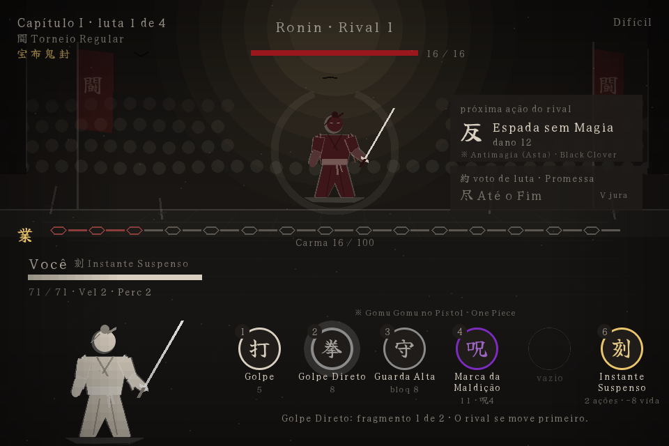
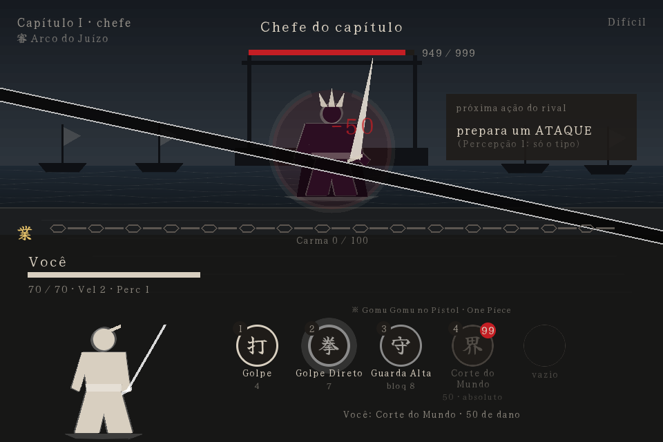

# Karmabound

**Torneio dark fantasy por turnos, com estética de anime, construído sobre a [Ouroboros Engine](https://github.com/EzioMilanoX/OuroborosEngine).**

Você não escolhe seu poder: **gira por ele**. Dons, técnicas, o arco de cada capítulo e as relíquias saem de rodas de sorteio desenhadas como uma mandala de selos. Todo azar fica preso ao seu **Carma** — e quando o Carma transborda, no pior momento, você **Desperta**.

> Protótipo jogável. Uma run inteira já se joga do título ao fim, e tudo o que sai da roleta vale na luta: mais de 270 habilidades — cada uma uma **homenagem** a um anime ou mangá, com a origem na carta —, Linhagens, Dons, técnicas, Relíquias, Arcos com arena própria, duplicatas que evoluem, o Altar dos Votos entre capítulos, o voto de luta (Promessa, Revelação ou Selo), o Despertar e o Grimório, com quatro modos de dificuldade calibrados por simulação. Executável do Windows pelo `build.bat`.

📖 **[Manual](docs/index.html)** — o jogo explicado por dentro: a roleta, o Carma, a luta e os votos. · 📚 **[Wiki](docs/wiki.html)** — todos os poderes, com busca.



## Rodando

Requisitos: Python ≥ 3.11, `pygame-ce` e a Ouroboros Engine com as primitivas de UI do marco M16 (círculos, arcos, polígonos e fontes customizadas).

```bash
# com o repositório da engine clonado ao lado (recomendado para dev):
pip install -e ../OuroborosEngine --no-deps
pip install numpy pygame-ce

# ou direto do GitHub:
pip install "ouroboros-engine @ git+https://github.com/EzioMilanoX/OuroborosEngine.git"

# na raiz deste repositório:
python -m karmabound
```

No Windows, **`run.bat`** na raiz faz o mesmo com duplo clique, e **`build.bat`** gera o executável em `dist\Karmabound\` (PyInstaller, onedir). Passo a passo e problemas comuns em [INSTALL.md](INSTALL.md). `python -m karmabound --roleta` abre só a roleta, como caixa de areia (Tab troca de roda; D e C enchem o Carma sem lutar).

### Controles

| Onde | Ação | Tecla |
|---|---|---|
| **Controle** (Xbox/XInput) | Mover · confirmar · voltar · pausa · Despertar · voto de luta | direcional/analógico · A · B · Start · Y · RB |
| Título | Escolher o modo / começar / Grimório / Crônica / opções | ↑ ↓ / Enter / G / C / O |
| Durante a run | Pausa: continuar, opções, quebrar um voto, voltar ao título | Esc |
| Opções | Música, efeitos, silenciar, tela cheia, velocidade, dicas | ↑ ↓ / ← → |
| Grimório | Trocar de roda / de habilidade / voltar | ← → / ↑ ↓ / Backspace |
| Roleta | Girar / escolher 1 de 3 / continuar | Espaço / 1–3 / Enter |
| Luta | Usar a técnica do selo (depois dos espaços: as técnicas do Dom e da Linhagem) | 1–8 (ou ← → e Enter) |
| Luta | Despertar (com o Carma cheio; não gasta o turno) | E |
| Luta | Voto de luta: ver e jurar o voto que a luta oferece (não gasta o turno) | V |
| Luta | Contrato: escolher a técnica sacrificada / desistir | 1–5 / Backspace |
| Espaços cheios | Trocar uma técnica / descartar a nova | 1–4 / Backspace |
| Altar | Mover / marcar restrição ou escolher opção / voltar | ↑ ↓ / Enter / Backspace |
| Altar (compra) | Comprar um nível do ganho / devolver / voltar | → ou Enter / ← / Backspace |
| Título e fim da run | Sair | Esc |

### Uma run

Título (o **modo de jogo** e a dificuldade) → **Linhagem** (seu sangue) → **Destino** (seu Dom) → para cada um dos 3 capítulos: **Arco** (a regra do capítulo) → 3 lutas e o chefe. Depois de cada vitória: 30% de cura e um giro de **Técnicas** (escolhe 1 de 3; com os 4 espaços cheios, troca uma). Às vezes, um giro de **Relíquias**. Toda luta oferece um **voto de luta** (V). No fim dos capítulos 1 e 2 abre o **Altar dos Votos**. A run acaba ao vencer as 12 lutas — ou ao cair.

### Modos de jogo

No título, ← → troca o modo; depois é só escolher a dificuldade.

| Modo | Como é |
|---|---|
| **Clássico** | 3 capítulos de 4 lutas; o chefe fecha cada um. |
| **Torre sem fim** | Os capítulos não acabam: a run só termina quando você cai, e o título guarda a sua maior altura em cada dificuldade. |
| **Desfile de chefes** | 6 lutas, todas contra chefes (3 capítulos de 2). |
| **Mundo de um anime** | Todas as rodas só com um anime (Naruto, One Piece, Bleach, Hunter x Hunter ou Jujutsu Kaisen). Uma raridade que o anime não tem numa roda entra com convidados de fora, para nenhuma roda ficar vazia. |

## A ideia em uma frase

Num roguelite, a sorte costuma ser o inimigo. Aqui ela é **o suspense**: cada giro ruim aproxima o Despertar, e o jogador passa a torcer pela desgraça quando o medidor está quase cheio.

## Homenagens: todo poder tem uma origem

Cada habilidade é uma homenagem com nome próprio, e a origem aparece na carta, na luta e no Grimório: a **Espiral Concentrada** é o Rasengan (Naruto), o **Clarão Negro** é o Kokusen (Jujutsu Kaisen), o **Corte do Mundo** é o corte que divide o mundo do Sukuna, o **Corpo Perfeito** é o Sukuna da Era Heian, o **Instante Suspenso** é The World (JoJo), a **Liberação Final** é o Bankai (Bleach). As obras vão de Naruto, One Piece, Bleach, Dragon Ball e Hunter x Hunter a Jujutsu Kaisen, Demon Slayer, Chainsaw Man, Berserk, Solo Leveling, Attack on Titan, Frieren, Mob Psycho 100, Fate, Dandadan e My Hero Academia — 34 animes. A [wiki](docs/wiki.html) mostra tudo, por roda ou por anime; o [catálogo](docs/CATALOGO.md) tem a mesma lista em texto.

A homenagem copia o que o poder **faz** na obra, não só o nome: as **Chamas Negras** (Amaterasu) não apagam e crescem a cada turno até incinerar, e cobram a visão para sempre (−1 de Percepção na run, como o Mangekyou); a **Armadura** do Guts não deixa você cair enquanto veste, mas cobra de uma vez todo o dano que segurou; o **Ritual de Sangue** (Hidan) faz o rival sofrer toda dor que você sofre, a começar pela estocada em si mesmo; a **Expansão de Domínio** acerta com certeza e depois queima o cérebro (todas as técnicas em recarga); o **Gon adulto** troca o resto da vida por dois turnos.

A **Crônica** (C, no título) guarda o histórico das suas runs e doze **Feitos** (vencer no Brutal, vencer sem Relíquias, quebrar um voto e vencer, completar o Grimório...). O **Grimório** (G, no título) guarda todas as habilidades que já saíram da roleta, entre runs; as que faltam aparecem como ???.

A run **fica salva** a cada fase: o título oferece **Continuar a run** (no meio de uma luta, ela recomeça igual — mesmo rival, mesma sorte). A **Semente do dia** dá a todo mundo a mesma sorte no Difícil, e o título mostra o seu melhor resultado do dia.

Na **primeira run**, cada sistema se explica uma vez, na primeira vez que aparece (dá para desligar ou rever nas opções). **Esc** pausa: dali se abrem as opções (volume da música e dos efeitos, silenciar, tela cheia, velocidade das animações) e se **quebra um voto**, com a punição e o voto de quebra.

### O visual

- **Um efeito por habilidade**, em tinta: a esfera que gira do Rasengan, os raios do Hekireki Issen, a lua negra do Getsuga, as correntes do Kurapika, o Domínio que fecha a arena, o tempo parado em sépia, a tela que se parte no Corte do Mundo.
- **Lutadores articulados**: um esqueleto com poses (parado respirando, guarda, ataque, golpe recebido), roupa e rosto por estilo. Rivais: Ronin, Monge Errante, Shinobi, Oni, Hollow e Titã; o chefe é um colosso de quatro braços, com uma **técnica-assinatura** (Senbonzakura, Susanoo, Chibaku Tensei, Kamui, Mugetsu, Leigan, o Bang da Makima, a Balança de Aura e a Respiração da Lua).
- **Arenas com profundidade**: camadas em parallax, luz, névoa, um primeiro plano na frente dos lutadores e a cena tremendo nos golpes. Doze Arcos, cada um com a sua (entre eles a Torre Celestial, a Floresta da Morte, Hueco Mundo, o Torneio do Poder, o Exame de Magos e a Guerra do Cálice).
- **Sombrio**: vinheta, grão de tinta, o sangue dos golpes que fica no chão, espadas quebradas fincadas e corvos no céu.
- **Uma aura por Despertar**, e cartas com moldura da raridade e a linha de origem.
- **Cinema**: o rival entra numa pincelada de tinta com o nome em caligrafia (o chefe escurece a tela antes); na vitória ele se desfaz em tinta, na derrota as correntes se fecham sobre você; o título respira (ensō, corrente do Carma, tinta escorrendo); entre telas, a tinta cobre e recolhe.
- **Som e música sintetizados em código** (`python tools/gerar_sons.py`): taiko, gongo, sinos, shamisen, koto, correntes e cortes, em escalas japonesas. Uma faixa para o título, a roleta, a luta e o chefe; a música da luta acelera quando o Carma enche.



## A roleta: seis rodas, um destino

| Roda | Decide | Modo |
|---|---|---|
| 血 **Linhagem** | O sangue de onde você vem (36): clãs, famílias e povos, com preço nas raras | gira e aceita |
| 命 **Destino** | O Dom inato (57) | gira e aceita |
| 技 **Técnicas** | Golpes, defesas, técnicas malditas e transformações (169) | gira 3, escolhe 1 |
| 章 **Arco** | A regra do capítulo (12: Lua de Sangue, Invasão, Maldição Coletiva, Guerra do Cálice…) | gira e aceita |
| 宝 **Relíquias** | Itens; duplicatas evoluem o que você já tem (42) | gira e aceita |
| 覚 **Despertar** | O tipo de Despertar (45), na luta: Bankai, Ultra Instinto, Modo Sábio, Infinito, Santuário Malévolo... | sorteio igual |

Tudo o que a roleta entrega vale na luta: a **Linhagem** (passivo, técnica de família ou uma técnica que já começa num espaço), o **Dom** (efeito passivo ou uma técnica própria, num 6º selo), as **Relíquias** (acumulam e se somam), o **Arco** (a regra do capítulo, para os dois lados — a Invasão até acrescenta uma luta) e as técnicas, que **evoluem** quando repetidas (2 fragmentos = nível II). Cada item foi medido em pontos de vitória contra uma régua por raridade.

Cada fatia é um **selo com um kanji**, colorido pela raridade: **Cinza** (60%), **Sangue** (28%), **Maldito** (10%), **Divino** (2%). O resultado é decidido antes da animação; o selo aceso só corre pelo círculo até ele. A tela mostra a **taxa publicada ao lado da taxa real** de cada raridade — sem dinheiro, nunca.

## Carma e Despertar

O Carma é um **pity compartilhado entre todas as rodas**. Ele enche com giros ruins, com dano recebido e com o preço dos poderes pagos — sofrer alimenta o Carma.

- **Pity suave:** acima de 60, Malditos e Divinos ficam até 3× mais prováveis. As correntes em volta da mandala racham e avermelham.
- **Transbordo:** em 100, as correntes tremem e o Carma fica esperando a luta.
- **Despertar:** na luta, quando você quiser (E, sem gastar o turno) — ou sozinho, quando um golpe for te matar: o golpe é anulado. O tipo sai da **Roda do Despertar**, com 45. Os doze primeiros: 報 Retribuição (a dor da luta volta ao rival), 奪 Tomar o Destino (rouba a melhor técnica dele), 醒 Forma Desperta (dano dobrado, sem recarga), 鳳 Renascer das Cinzas (cura total e escudo), 卍 Liberação Final (Bankai), 極 Instinto Puro (Ultra Instinto), 仙 Modo Eremita (Modo Sábio), 痣 Marca do Caçador, 獣 Fera Interior (Modo Kurama), 無 Vazio Infinito (o Infinito do Gojo), 竜 Dragão Negro (Kokuryuha) ou 戻 Retorno pela Morte (Re:Zero); os outros trinta e três estão na [wiki](docs/wiki.html). E o próximo giro depois da luta vem Divino garantido.
- **Calibrado** por simulação de lutas reais: cerca de **1,2 Despertar por run**. Algumas runs terminam sem nenhum — nem todo mundo recebe seu momento.

## Lutas: só recarga

Duelo 1v1, turnos alternados, regras curtas:

- Você usa **uma técnica pronta** por turno; ela fica fora por alguns turnos seus. O **Golpe básico** nunca entra em recarga.
- **4 espaços** de técnica. **Vida persiste** na run, com 30% de cura entre lutas.
- **Velocidade** decide quem começa — e quem começa tenta um **ataque surpresa** (+50% de dano se não for percebido).
- **Percepção é sentir o perigo:** contra golpe perigoso, se a sua Percepção for ≥ a **Sutileza** do golpe, você leva metade e devolve um golpe. Determinístico, sem dado; calibrado para salvar ~33% das vezes.
- **O rival anuncia** a próxima ação e cumpre. Sua Percepção decide o quanto você vê: nada, o tipo, ou a técnica.
- **Além de dano, bloqueio e cura:** sangrar, bomba, detonar, silenciar, desarmar, cegar, expor, drenar, executar, acumular, combo, gravidade, desespero, fera, instinto, intocável, espelho e acelerar. Algumas técnicas de preparo **não gastam o turno** ("livre" no selo).
- **O que fere com o tempo:** o **sangramento** dura 3 turnos; o **veneno** acumula doses que ferem e caem 1 por turno; a **chama negra** não apaga e cresce 1 a cada turno até o fim da luta. **Purificar** tira sangramento, veneno, Marca e selos — a chama negra, nunca.
- **Gelo:** congelar tira o turno do rival, e o próximo golpe nele causa ×2 e quebra o gelo.
- **Quem luta ao seu lado:** **clones** atacam junto (40% do golpe) e somem no lugar de um golpe que você levaria; **invocações** ferem sozinhas a cada turno seu, por alguns turnos.
- **Transformações** (Modo Sábio, Super Saiyajin, Bankai, Gear, Godspeed, Titã, Expansão de Domínio...): por alguns turnos você fica mais forte, sem gastar o turno, e quando a forma acaba vem o preço — vida por turno, turnos perdidos, técnicas em recarga ou vida máxima perdida para sempre. Uma forma por vez; trocar de forma cobra a anterior.

### Modos de dificuldade

Calibrados com um piloto automático simples em 12 lutas — um jogador de verdade, lendo o rival, vence mais.

| Modo | Vitória (piloto) | Rivais | Sua vida |
|---|---|---|---|
| Acessível | ~45% | 12 + 3,19 por luta, chefe ×1,2 | 80 |
| Equilibrado | ~36% | 12 + 3,46 por luta, chefe ×1,2 | 76 |
| **Difícil** (padrão) | ~25% | 12 + 3,87 por luta, chefe ×1,25 | 70 |
| Brutal | ~10% | 12 + 5,21 por luta, chefe ×1,25 | 68 |

### Poderes com preço

Os poderes mais raros são quebrados de propósito — e cobram à altura. Cada um foi medido em pontos de vitória contra uma régua (Maldito +5 a +10, Divino +10 a +20):

| Poder | Raridade | O que faz | O preço | Vale |
|---|---|---|---|---|
| 呪 Marca da Maldição | Maldito | Golpe de 10; o rival sofre 4 por turno, e Marcas se somam | você sofre 1 por turno por Marca | +4,5 |
| 幻 Lua Ilusória (Tsukuyomi) | Maldito | O rival perde o próximo turno | 2 de vida: os olhos sangram | +7 |
| 界 Corte do Mundo (Sukuna) | Divino | 50 de dano que atravessa bloqueio, escudo e esquiva, impossível de perceber | só fica pronto no seu 4º turno | +9,5 |
| 宿 Corpo Perfeito (Sukuna Heian) | Divino | Quatro braços: o Golpe acerta 2× com +2 | você nunca defende | +13 |
| 卵 Ovo do Eclipse (Behelit) | Divino | Desperta à beira da morte, mesmo sem Carma (1×/run) | o seu Dom é sacrificado | +16 |
| 契 Contrato | Divino | Golpe de 40, uma vez por luta; cresce +7 a cada técnica consumida | destrói uma das suas outras técnicas para sempre | +12 |
| 裁 Julgamento | Divino | Dano = 1,8 × o seu Carma | consome todo o Carma — e o Despertar que vinha com ele | +15 |

## Votos vinculativos

O **Altar dos Votos** abre sozinho no fim dos capítulos 1 e 2, fora da luta (dá para recusar). Lá você monta o próprio voto, como nos animes. Escolhe **restrições** — simples (−25% de vida), de conduta (nunca usar defesa), de revelação (o rival te lê melhor) ou de risco (cair abaixo de 20% é morte) — e os pontos compram **ganhos**: simples em níveis (Força, Vigor, Percepção, Velocidade), especiais (Golpe Oculto, Primeiro Sangue…) e exclusivos (Segunda Vida, Carrasco, Sangue Frio).

**Você compra os ganhos.** O Altar abre com a compra que ele faria já marcada, e você mexe à vontade — mas às cegas: sem preço nem estimativa, só uma barra com a **força do voto** que resta e o aviso de quando um ganho não cabe mais. O que você não gastar **fica guardado** para o próximo voto (dá até para jurar só as restrições e guardar toda a força).

O que torna o sistema diferente: **o valor de uma restrição não é tabelado**. O Altar simula o resto da sua run com e sem ela e mede o potencial que você realmente sacrificaria. Proibir o que você não usa não rende nada; proibir o seu melhor golpe rende muito. Sacrifícios maiores e permanentes rendem mais que a soma, mas cada restrição tem um teto — para ir além, é preciso combinar restrições diferentes. Quebrar um voto é possível, com punição e um voto de quebra que, se quebrado, encerra a run. São 16 restrições e 20 ganhos. (Até 2026-11-04 o Altar só abria quando a roleta tirava o Juramento; ele saiu da roleta e virou mecânica.)

### O voto da luta

Dentro da luta há um voto menor e diferente: toda luta oferece **um**, sorteado entre três tipos, e você jura uma vez, sem gastar o turno (V).

- **約 Promessa**: uma condição (vencer em 3 turnos, não ser ferido, só usar o Golpe…). Dá algo agora; cumprir dá prêmio, falhar cobra.
- **明 Revelação**: mostrar algo ao rival. Poder agora; ele te lê melhor.
- **封 Selo**: abrir mão de uma parte do seu kit até o fim da luta (as defesas, o Golpe, o Despertar…) em troca de força.

O conceito vive também como blueprint reutilizável (**GAM-11 O.A.T.H.**).

## Arquitetura

Híbrida: **regras em Python puro**, **apresentação pela engine**.

```
karmabound/
  rodas.py      dados das rodas e sorteio por seed
  carma.py      pity suave e duro, compartilhado
  mesa.py       uma sessão de giros: a tela e o simulador giram pela mesma Mesa
  combate.py    a luta 1v1 por recarga, IA do rival e piloto automático
  efeitos.py    o que votos, Dons e Relíquias fazem no lutador
  votos.py      catálogo, pontos, teto, preço e quebra dos votos
  votos_luta.py o voto da luta: Promessa, Revelação e Selo
  run.py        os passos de uma run (Dom, Arco, luta, técnica, relíquia) + o piloto automático
  simulacao.py  runs em massa para calibrar
  jornada.py    a run jogada por uma pessoa, fase a fase (as telas só chamam a Jornada)
  tela_roleta.py  a mandala, as correntes e o Despertar (IScene da engine)
  tela_luta.py  o duelo frente a frente
  tela_menus.py título, troca de técnica, Altar dos Votos e fim
  figuras.py    as silhuetas de tinta (5 estilos), feitas de polígonos
  vfx.py        um efeito de tinta por habilidade e uma aura por Despertar
  arenas.py     o cenário de cada Arco
  som.py        efeitos e música por nome (mudo até o jogo configurar)
  grimorio.py   o que já saiu da roleta, salvo entre runs (~/.karmabound)
  tela_grimorio.py  o Grimório: todas as habilidades, com a origem
  visual.py     paleta, fonte e utilitários de desenho
  game.py       o Fluxo: põe a tela da fase atual da Jornada no topo da engine
  data/         rodas, balanceamento, controles e votos em JSON
```

- **Tudo que é número está em JSON** (`karmabound/data/`): raridades, Carma, técnicas, modos, votos.
- A tela desenha só pela API do `IRenderer` da engine (`draw_ui_*`, `draw_text` com fonte própria) — nunca com pygame direto.
- O sorteio é sempre por **seed**: qualquer bug de sorte é reproduzível.

## Ferramentas e testes

```bash
pytest                              # testes headless, incluindo runs inteiras jogadas pelas telas
ruff check .                        # lint
python tools/simular.py --combate   # vitórias, Carma e Percepção por modo
python tools/medir_juramento.py     # quanto o Altar vale em pontos de vitória
python tools/medir_poder.py         # quanto cada Dom, Relíquia e técnica vale, contra a régua
python tools/afinar.py              # mede os itens novos e ajusta o número principal à régua (--aplicar grava)
python tools/medir_tipicos.py       # valores típicos do Altar rápido do simulador (--aplicar grava)
python tools/calibrar.py tudo       # o ciclo inteiro: modos no alvo (--aplicar grava) e itens contra a régua
python tools/gerar_catalogo.py      # regenera docs/CATALOGO.md e docs/wiki.html a partir dos JSON
python tools/capturar_telas.py      # PNG de cada estado da roleta e das telas da run, em docs/telas/
python tools/vitrine.py             # PNG de cada arena, rival e efeito, em docs/telas/vitrine/
python tools/gerar_sons.py          # sintetiza os efeitos e as músicas em assets/ (WAV)
python tools/gerar_icone.py         # o ícone (業 dourado) em assets/
```

## Documentação

- **[docs/index.html](docs/index.html)** — o manual.
- **[docs/wiki.html](docs/wiki.html)** — a wiki: todo item do jogo numa ficha (linhagens, Dons, técnicas, arcos, relíquias, Despertares, técnicas de chefe e votos), com busca e filtro de raridade. Gerada dos JSON.
- **[docs/DESIGN.md](docs/DESIGN.md)** — todas as decisões de design, com data e motivo.
- **[docs/CATALOGO.md](docs/CATALOGO.md)** — todo o conteúdo (rodas, técnicas, votos, modos), gerado dos dados.
- **[docs/telas/](docs/telas/)** — capturas de cada estado da roleta; **[docs/telas/vitrine/](docs/telas/vitrine/)**, as arenas e os efeitos.

## Licença

Uso para testes e avaliação; todos os direitos reservados — ver [LICENSE](LICENSE). A fonte **Yuji Syuku** (`assets/fonts/`) é distribuída sob a SIL Open Font License 1.1 ([OFL.txt](assets/fonts/OFL.txt)).
