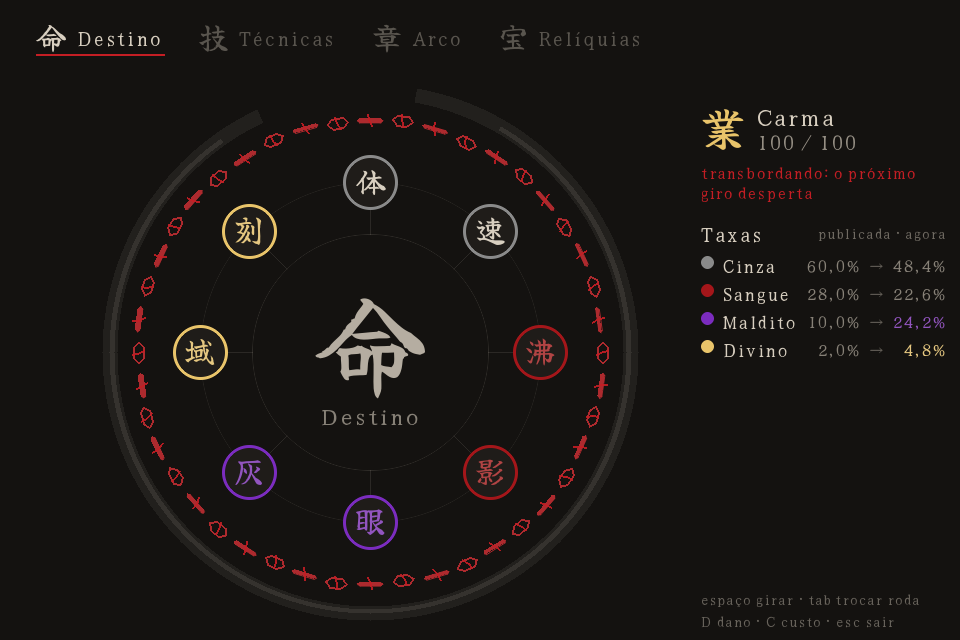

# Karmabound

**Torneio dark fantasy por turnos, com estética de anime, construído sobre a [Ouroboros Engine](https://github.com/EzioMilanoX/OuroborosEngine).**

Você não escolhe seu poder: **gira por ele**. Dons, técnicas, o arco de cada capítulo e as relíquias saem de rodas de sorteio desenhadas como uma mandala de selos. Todo azar fica preso ao seu **Carma** — e quando o Carma transborda, no pior momento, você **Desperta**.

> Protótipo (v0). Já existem a roleta jogável, as regras de combate com quatro modos de dificuldade calibrados por simulação, e o sistema de votos vinculativos. Ainda não há tela de luta nem executável.

📖 **[Manual](docs/index.html)** — o jogo explicado por dentro: a roleta, o Carma, a luta e os votos.



## Rodando

Requisitos: Python ≥ 3.11, `pygame-ce` e a Ouroboros Engine com as primitivas de UI do marco M16 (círculos, arcos, polígonos e fontes customizadas).

```bash
# com o repositório da engine clonado ao lado (recomendado para dev):
pip install -e ../OuroborosEngine --no-deps
pip install numpy pygame-ce

# ou direto do GitHub:
pip install "ouroboros-engine @ git+https://github.com/EzioMilanoX/OuroborosEngine.git"

# na raiz deste repositório:
python -m karmabound
```

No Windows, **`run.bat`** na raiz faz o mesmo com duplo clique. Passo a passo e problemas comuns em [INSTALL.md](INSTALL.md).

### Controles da roleta

| Ação | Tecla |
|---|---|
| Girar | Espaço |
| Trocar de roda (Destino, Técnicas, Arco, Relíquias) | Tab |
| Escolher uma das 3 técnicas sorteadas | 1, 2, 3 |
| Sofrer dano / pagar um custo (para encher o Carma sem lutar) | D / C |
| Sair | Esc |

## A ideia em uma frase

Num roguelite, a sorte costuma ser o inimigo. Aqui ela é **o suspense**: cada giro ruim aproxima o Despertar, e o jogador passa a torcer pela desgraça quando o medidor está quase cheio.

## A roleta: quatro rodas, um destino

| Roda | Decide | Modo |
|---|---|---|
| 命 **Destino** | O Dom inato e a origem do personagem | gira e aceita |
| 技 **Técnicas** | Golpes, defesas e técnicas malditas | gira 3, escolhe 1 |
| 章 **Arco** | A regra do capítulo (Lua de Sangue, Invasão, Maldição Coletiva…) | gira e aceita |
| 宝 **Relíquias** | Itens; duplicatas evoluem o que você já tem | gira e aceita |

Cada fatia é um **selo com um kanji**, colorido pela raridade: **Cinza** (60%), **Sangue** (28%), **Maldito** (10%), **Divino** (2%). O resultado é decidido antes da animação; o selo aceso só corre pelo círculo até ele. A tela mostra a **taxa publicada ao lado da taxa real** de cada raridade — sem dinheiro, nunca.

## Carma e Despertar

O Carma é um **pity compartilhado entre todas as rodas**. Ele enche com giros ruins, com dano recebido e com o preço dos poderes pagos — sofrer alimenta o Carma.

- **Pity suave:** acima de 60, Malditos e Divinos ficam até 3× mais prováveis. As correntes em volta da mandala racham e avermelham.
- **Transbordo:** em 100, as correntes tremem e o Carma trava até o Despertar — um giro bom não apaga um Despertar garantido.
- **Despertar:** as correntes se partem, 覚醒 em dourado, e sai um giro Divino garantido.
- **Calibrado** por simulação de lutas reais: cerca de **1,3 Despertar por run**, o primeiro perto do meio da run. Algumas runs terminam sem nenhum — nem todo mundo recebe seu momento.

## Lutas: só recarga

Duelo 1v1, turnos alternados, regras curtas:

- Você usa **uma técnica pronta** por turno; ela fica fora por alguns turnos seus. O **Golpe básico** nunca entra em recarga.
- **4 espaços** de técnica. **Vida persiste** na run, com 30% de cura entre lutas.
- **Velocidade** decide quem começa — e quem começa tenta um **ataque surpresa** (+50% de dano se não for percebido).
- **Percepção é sentir o perigo:** contra golpe perigoso, se a sua Percepção for ≥ a **Sutileza** do golpe, você leva metade e devolve um golpe. Determinístico, sem dado; calibrado para salvar ~33% das vezes.
- **O rival anuncia** a próxima ação e cumpre. Sua Percepção decide o quanto você vê: nada, o tipo, ou a técnica.

### Modos de dificuldade

Calibrados com um piloto automático simples em 12 lutas — um jogador de verdade, lendo o rival, vence mais.

| Modo | Vitória (piloto) | Rivais | Sua vida |
|---|---|---|---|
| Acessível | ~45% | 12 + 2 por luta, chefe ×1,2 | 80 |
| Equilibrado | ~36% | 12 + 2 por luta, chefe ×1,2 | 76 |
| **Difícil** (padrão) | ~25% | 12 + 2 por luta, chefe ×1,25 | 72 |
| Brutal | ~10% | 12 + 2,5 por luta, chefe ×1,25 | 70 |

## Votos vinculativos (o Juramento)

Tirar o **Juramento** na roleta abre o **Altar dos Votos**: você monta o próprio voto, como nos animes. Escolhe **restrições** — simples (−25% de vida), de conduta (nunca usar defesa), de revelação (o rival te lê melhor) ou de risco (cair abaixo de 20% é morte) — e os pontos compram **ganhos**: simples em níveis (Força, Vigor, Percepção, Velocidade), especiais (Golpe Oculto, Primeiro Sangue…) e exclusivos (Segunda Vida, Carrasco, Sangue Frio).

O que torna o sistema diferente: **o valor de uma restrição não é tabelado**. O Altar simula o resto da sua run com e sem ela e mede o potencial que você realmente sacrificaria. Proibir o que você não usa não rende nada; proibir o seu melhor golpe rende muito. Sacrifícios maiores e permanentes rendem mais que a soma, mas cada restrição tem um teto — para ir além, é preciso combinar restrições diferentes. Quebrar um voto é possível, com punição e um voto de quebra que, se quebrado, encerra a run. Calibrado, o Juramento vale cerca de **+13 pontos de vitória**.

O conceito vive também como blueprint reutilizável (**GAM-11 O.A.T.H.**).

## Arquitetura

Híbrida: **regras em Python puro**, **apresentação pela engine**.

```
karmabound/
  rodas.py      dados das rodas e sorteio por seed
  carma.py      pity suave e duro, compartilhado
  mesa.py       uma sessão de giros: a tela e o simulador giram pela mesma Mesa
  combate.py    a luta 1v1 por recarga, IA do rival e piloto automático
  efeitos.py    o que votos (e depois Dons/Relíquias) fazem no lutador
  votos.py      catálogo, pontos, teto, preço e quebra dos votos
  run.py        uma run continuável — base do simulador e da medição do Altar
  simulacao.py  runs em massa para calibrar
  tela_roleta.py  a mandala, as correntes e o Despertar (IScene da engine)
  game.py       composição sobre a OuroborosEngine
  data/         rodas, balanceamento, controles e votos em JSON
```

- **Tudo que é número está em JSON** (`karmabound/data/`): raridades, Carma, técnicas, modos, votos.
- A tela desenha só pela API do `IRenderer` da engine (`draw_ui_*`, `draw_text` com fonte própria) — nunca com pygame direto.
- O sorteio é sempre por **seed**: qualquer bug de sorte é reproduzível.

## Ferramentas e testes

```bash
pytest                              # testes headless (regras, tela, votos, calibração)
ruff check .                        # lint
python tools/simular.py --combate   # vitórias, Carma e Percepção por modo
python tools/medir_juramento.py     # quanto o Juramento vale em pontos de vitória
python tools/gerar_catalogo.py      # regenera docs/CATALOGO.md a partir dos JSON
python tools/capturar_telas.py      # PNG de cada estado da roleta em docs/telas/
```

## Documentação

- **[docs/index.html](docs/index.html)** — o manual.
- **[docs/DESIGN.md](docs/DESIGN.md)** — todas as decisões de design, com data e motivo.
- **[docs/CATALOGO.md](docs/CATALOGO.md)** — todo o conteúdo (rodas, técnicas, votos, modos), gerado dos dados.
- **[docs/telas/](docs/telas/)** — capturas de cada estado da roleta.

## Licença

Uso para testes e avaliação; todos os direitos reservados — ver [LICENSE](LICENSE). A fonte **Yuji Syuku** (`assets/fonts/`) é distribuída sob a SIL Open Font License 1.1 ([OFL.txt](assets/fonts/OFL.txt)).
